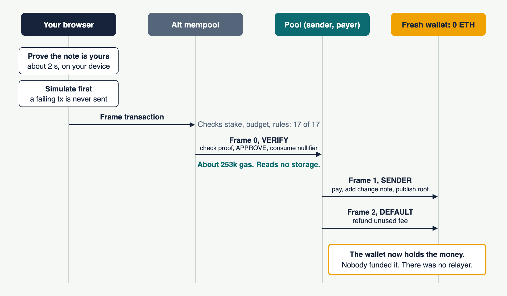
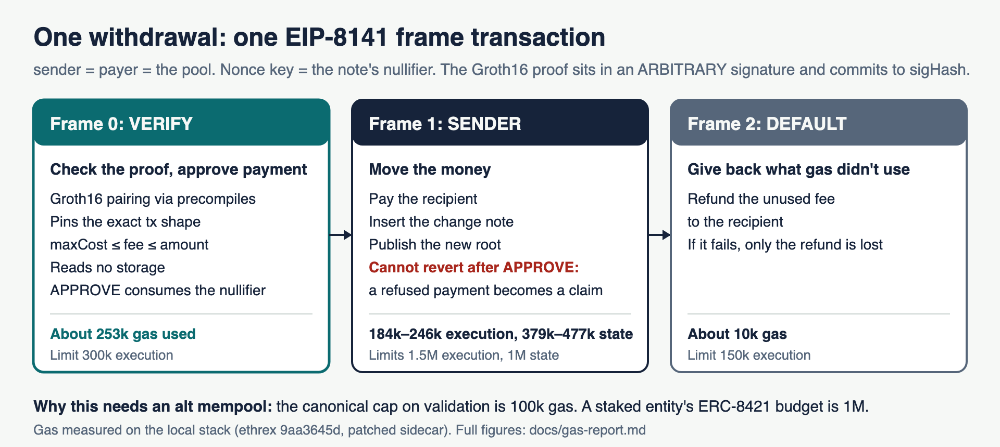

# Relayless

**Pay anyone privately, from a wallet with no history. No relayer. It tells you how hidden you are before you pay.**

- **What:** a privacy pool that pays gas from the note being withdrawn, so a brand-new wallet holding 0 ETH can receive money with nobody funding it, using EIP-8141 frame transactions and the alt mempool.
- **See it:** [live ENS directory and private names](https://relayless-ens.vercel.app) (Sepolia, nothing to install), [findings](https://relayless-ens.vercel.app/findings), video: *link to be added*.
- **Run it:** `scripts/local-stack.sh && pnpm web`, then open http://127.0.0.1:5199. See [Run it](#run-it).


| Part | What's real | Where it runs |
|---|---|---|
| Core: frame withdrawals, recovery, meter, k-gate | Works end to end, with 34 e2e checks | Local devnet: ethrex `9aa3645d` plus a patched sidecar, which the alt mempool authors confirmed is fine for judging. The public gateway can't admit these yet: see [Findings](#findings-for-the-alt-mempool) |
| Association set and World ID | Works, verified by World's **staging** service with its simulator | Local devnet. Production and a real World App aren't tested |
| ENSv2 directory and private names | Deployed | Sepolia, [live link](https://relayless-ens.vercel.app). Pool steps run on the devnet |
| Nym mixnet | Optional, off by default, covers ENS reads only | Live link and local app. See [CROPS](#crops) |

Devnet only. Not audited.

## What you get
Privacy pools with no relayer have been prototyped. This is the layer that makes one usable:

- **One seed, nothing to back up.** Your wallet signs once. Notes and fresh addresses derive from that signature, and everything, change notes included, can be rebuilt from the chain on any device.
- **Pay any amount.** Partial payments leave a change note. A payment bigger than any one note splits across several, all pending at once.
- **Withdrawals don't wait for each other.** Each one has its own nullifier as its nonce key, and validation reads no storage. So one pool can serve many users at the same moment.
- **See how hidden you are.** Every deposit is drawn as a dot, sized by how suspicious it looks from outside. You get min-entropy and Shannon scores, plus advice you can act on: wait, split, or change the amount. It's an explicit model, not a guarantee.
- **Enforce it if you want.** Require at least *k* notes after yours, checked inside the proof.
- **Compliance path.** An optional association set: only approved deposits withdraw privately, and anyone else can always exit publicly to the wallet that deposited. *The set, the exit and World ID work locally against World's staging service.*
- **ENS as the directory.** Find association-set providers by name, and check each one's root against the pool's chain. Pay `alice.relayless.eth` twice and nobody can link the payments. See [ENSv2](#ensv2).

## Findings for the alt mempool
Building a pool where every user shares one sender surfaced these, each reproducible:

| Finding | Evidence | Status |
|---|---|---|
| **Verification over 100k is rejected, even for a staked sender.** The cap runs before stake is looked up | Live gateway: `250000 exceeds MAX_VERIFY_GAS 100000`, from a sender with a real stake | Fixed in our local patch. [Repro](docs/repro-gateway.md) |
| **Precompile calls are rejected during validation, even under the cap** (`COD-010`), because `precompiles` is empty in the gateway's config | Live gateway rejects a 60k frame calling `0x06` | Config fix locally. [Repro](docs/repro-gateway.md) |
| **Replacements inflate reputation.** Each fee bump counted as a new `seen`, against ERC-8421's REPUTATION-040. **The alt mempool authors confirmed this as a prototype bug** | 8 bumps from one note: `seen` 0 → 8 before our fix, 0 → 1 after | Fixed in our patch. [Write-up for upstream](docs/upstream-pr.md) |
| **A note owner can grief the shared sender across nodes.** A node that never sees the tx mined keeps it against the pool | Same note sent to two nodes: `seen 2, included 0` on the non-mining one | **Open.** It needs a rule change. At that rate, throttling a node takes about 110 notes and banning about 510 (calculated, not reached) |

### Why allowing precompiles in validation is safe
ERC-8421's CALLING-040 already allows `0x01–0x11` and `P256VERIFY`, and only the gateway's config blocks them. These precompiles are:

- **Pure and deterministic:** the output depends only on the input, so a result can't differ because of who runs it or when.
- **Stateless:** they read no storage, balance, code or block data, and write nothing.
- **Gas-bounded:** each call is priced from its input and counts against the entity's validation budget, so a transaction can't spend more than it declared.

So they add no mass-invalidation risk for builders. Nothing another transaction does can change a precompile's result, and a precompile call can't change anything another transaction depends on, so a block landing gives a builder nothing extra to revalidate.

**What else changes:** allowing precompiles is a config value. [The patch](patches/sidecar-budget-010.patch) otherwise changes only per-entity gas budgets (BUDGET-010), plus the replacement fix (REPUTATION-040).

**One limit:** this is about correctness, not cost. Gas doesn't price CPU evenly, and [Nethermind's follow-up to the budget research](https://ethresear.ch/t/eip-8141-and-minimum-required-validation-budget-for-privacy-applications/25889) reports a real circuit costing about 3.3x more CPU per gas than a synthetic one. So the budget is what limits node work, and a node should set it with that in mind.

[Everything about reputation and griefing, with mitigations](docs/reputation-analysis.md).

The authors confirmed a local sidecar is fine for judging. Separately, ethrex lost the number lookup for a run of blocks on 2 of 2 fresh chains; the cause is unknown, and the SDK reads around it. See the [write-up](docs/upstream-pr.md#separate-issue-ethrex-loses-block-numbers).

## How it works
EIP-8141 frame transactions let the pool be the sender and pay gas from the note being withdrawn. A fresh wallet receives money without ever holding ETH.





| Mechanism | How |
|---|---|
| Double spends | The nullifier is an EIP-8250 nonce key, consumed atomically with payment approval. A second spend is an invalid transaction, not a paid failure |
| Root | Referenced as an EIP-8272 recent root, not read from storage. Bound to the leaf count, for the k-gate |
| Binding | The proof sits in an `ARBITRARY` signature and commits to `sigHash`, so recipient, fee and every frame are fixed |
| Pool safety | The validator pins the exact transaction shape, and `maxCost ≤ fee ≤ amount`, so one note can't spend others' money |
| Note safety | The SENDER frame cannot revert after APPROVE. A refused payment becomes a claim, not a lost note |

**The most interesting problem is the shared sender.** Reputation drops for every transaction admitted but not mined, and every user shares the pool's. [docs/reputation-analysis.md](docs/reputation-analysis.md) lists every way this can happen, with griefing measurements, what we mitigated, and what needs a rule change.

## Run it
Needs Docker (running), Node, pnpm and Foundry. From a fresh clone, one command brings up a private local chain and the patched alt mempool, then deploys:

```sh
scripts/local-stack.sh   # about 13 minutes the first time: frame transactions activate about 11 minutes after genesis
pnpm web                 # http://127.0.0.1:5199
```

Everything binds to localhost, and the keys it creates are throwaway. It's safe to rerun: it reuses a running stack and deploys a fresh pool. To stop, run the command it prints at the end.

The association-set pool and World ID are optional: see [docs/world-id-setup.md](docs/world-id-setup.md).

**Demo mode.** Open the app with `?demo=1` for the demo buttons and fewer raw addresses on screen. To prepare it on the second association-set pool (`scripts/ens/setup-second-pool.sh`), which is what the demo uses:

```sh
pnpm demo:asp                               # that pool's ASP, on 8791, in its own terminal
pnpm demo:seed                              # demo data, see below
pnpm demo:reset                             # a new wallet and fresh recipient, for each take
RELAYLESS_NETWORK=local-asp2 pnpm web
pnpm demo:prep                              # a green or red line for everything; --fix runs the safe fixes
```

**Demo data, clearly:** `demo:seed` makes 56 deposits from throwaway keys into that pool, so the meter and dot chart have a crowd. **Those dots are seed data, not users.** They and the demo wallet are approved directly by the operator of `allowlist.asp.relayless.eth`, which is that ASP's stated policy. They never enter the World ID ASP's set.

Tests:

```sh
pnpm test:circuits && pnpm test:contracts && pnpm test:sdk && pnpm test:asp
(cd packages/ens && forge test)   # on forked Sepolia, against the deployed ENSv2 contracts
set -a; . ./.env; set +a
pnpm e2e                 # against the running stack
npx tsx scripts/e2e-asp.ts && npx tsx scripts/e2e-world.ts
npx tsx scripts/e2e-ens.ts       # real Sepolia transactions, from the throwaway keys
```

Latest results are in [PROGRESS.md](PROGRESS.md).

SDK:

```ts
const rl = await Relayless.connect({ rpc, mempool, pool, signer, prover });
await rl.deposit({ amount });
await rl.pay({ to, amount, minAnon: 32 });
const a = await rl.anonymity({ amount }); // { minEntropyBits, shannonBits, setSize, advice }
```

CLI: `npx tsx packages/cli/src/cli.ts deposit|withdraw|anonymity|recover|fresh|ragequit`

## ENSv2
ENS is how you find out who approves deposits, and how you pay someone without exposing where their money lands. Both run on the ENSv2 contracts on Sepolia. The pool stays on the local devnet.

**Live demo: https://relayless-ens.vercel.app.** It reads Sepolia directly from your browser, with no server of ours. Browse the ASPs, see who holds which role, look up `alice.relayless.eth` and derive stealth addresses. Pool steps say they run on the local devnet.

**Check it yourself.** The curator tries to edit the World ID ASP's root, and the resolver refuses with `EACUnauthorizedAccountRoles` (`0x4b27a133`):
```
cast call --rpc-url https://ethereum-sepolia-rpc.publicnode.com 0x335dd5348EbEA119DB2644831801C290ECF0B4e7 \
  "setText(bytes,string,string)" 0x05776f726c64036173700972656c61796c6573730365746800 asp.root 0xdead \
  --from 0x04f1D2215933f26f07c343511a7E05717273e6BE
```
Change `--from` to the operator, `0xd5cf58D5718c9A7308371913f62096E005AF450D`, and it succeeds. Keep the operator and change `asp.root` to `asp.pool`, and it reverts again.

### ASP directory
- **Permissioned Registry:** `asp.relayless.eth` has its own registry. Each ASP is a subname of it, such as `world.asp.relayless.eth`. The app lists ASPs from that registry's `LabelRegistered` events, with no list in the code.
- **Permissioned Resolver:** each ASP has its own, holding the root, slot, policy, chain, pool, operator and approval endpoint.
- **EAC:** the operator key can edit only `asp.root`, `asp.slot` and `asp.policy`. The curator can't edit any record.
- **Publishing:** the World ID ASP's server publishes its root when the approved set changes, and on its 6-hour refresh, because a referenced root expires after about 13.6 hours. A Sepolia failure never blocks a join.
- **Cross-check:** ENS is the directory and the pool's chain is the truth. The SDK reads the root from the chain's recent-root predeploy, and warns if ENS disagrees or if the pool takes roots from a different operator. `forged-demo.asp.relayless.eth` is deliberately wrong, to show that warning.

### Private receive names
- **Claim:** `RelaylessNameClaimer` registers `alice.relayless.eth` directly to the recipient, as a name that never expires, with no server involved.
- **Record:** the name's own resolver holds a stealth meta-address in the `stealth-meta-address` text record (ERC-5564 scheme 1).
- **EAC:** an app key can edit only that record. It can't edit other records, set an address, repoint the name or pass its role on.
- **Paying:** the payer derives a new one-time address, and the pool pays it. A fresh wallet funded by a pool withdrawal publishes the announcement first, so a payment can't arrive unfindable. The recipient scans with a viewing key.

### Design choices
- **No rotating `addr`.** Anyone could read each `addr` value from chain history and link every address the name ever used. A meta-address gives only the payer each one-time address, and it never appears in ENS.
- **Subname rules.** ASP names expire after a year, can't be transferred, and can't be pulled early by the curator. A bad ASP can only over-approve or withhold, public exit stays open, and slow visible removal is enough. Receive names never expire and belong to the recipient. Reasons are in [DECISIONS.md](DECISIONS.md).
- **No wildcards or aliasing.** A wildcard can't list names, and the point of the directory is that it can be listed. Every name here is a real entry with its own roles.

### Why ENS is central
Without ENS there's no way to find an ASP, nothing that shows who may change its record, and no way to pay a name privately. The role limits are enforced by the ENSv2 contracts, not by this app.

### On Sepolia
| What | Name | Address |
|---|---|---|
| Parent registry | `relayless.eth` | [`0xa301…87F2`](https://sepolia.etherscan.io/address/0xa30168D50Dfa55C2bCe1ed726F86eAFeA3Af87F2) |
| Directory registry | `asp.relayless.eth` | [`0x1511…033F`](https://sepolia.etherscan.io/address/0x1511b0aF97942f939b4F7369b016fAc70ee6033F) |
| World ID ASP resolver | `world.asp.relayless.eth` | [`0x335d…B4e7`](https://sepolia.etherscan.io/address/0x335dd5348EbEA119DB2644831801C290ECF0B4e7) |
| Allowlist ASP resolver | `allowlist.asp.relayless.eth` | [`0x891e…B27E`](https://sepolia.etherscan.io/address/0x891eE68599a0fCcFF956Ee07eB14417255c0B27E) |
| Forged demo resolver | `forged-demo.asp.relayless.eth` | [`0xc30b…1c07`](https://sepolia.etherscan.io/address/0xc30b6a4eA7c8b0E81e0D9Cc45F0A2D7fEcb21c07) |
| Name claimer | | [`0x0a1f…d85b`](https://sepolia.etherscan.io/address/0x0a1f421cd39dd9015483d6c16aec6ffc819cd85b) |
| Test receive name's resolver | `alice.relayless.eth` | [`0x287d…9217`](https://sepolia.etherscan.io/address/0x287d90766ACA7f41CF407994448c2Cd90A049217) |

Both registries report `isEmancipated() == true`. Protocol addresses are in [config/ens.sepolia.json](config/ens.sepolia.json).

**Current limit:** the deployer still holds the subregistry role on `relayless.eth` and on `asp`, so it could replace everything beneath them. Removing that role is permanent and hasn't been done yet. Until then, "the parent can't change the root" holds for the current registries, not for a swap of them.

**The approval endpoint** in the ASP records is `http://127.0.0.1:8790`, because the ASP server runs locally with the devnet.

## CROPS
- **C:** We run no server, relayer or RPC. You depend on a mempool node and an RPC, which anyone can run. If a node refuses you, use another. The pool has no owner and can't be upgraded or paused. The exception is the association set, if a pool uses one: its operator decides who can withdraw privately, and public exit stays open regardless.
- **O:** GPL-3.0, because circomlib's GPL-3.0 circuits are compiled into the project (see [NOTICE.md](NOTICE.md)). Builds and runs from this repo, using a patched third-party sidecar until the public gateway supports it.
- **P:** The RPC and mempool node see your IP, and everything on-chain is public: deposits, amounts, recipients, and *k*. Reads fetch all deposits, so they don't reveal which are yours. No trackers or analytics: a full browser run contacted no outside host, and fonts are self-hosted. On a pool with an association set, choosing to verify contacts World, and the ASP links a World ID nullifier to a depositor address, which is already public. Anon-RPC isn't integrated, as its docs list no devnet support.
  **ENS lookups:** we run no server here, so we can't see them. The Sepolia RPC can: it sees your IP and every name you resolve, so looking up `alice.relayless.eth` tells it you're interested in that name, though not whether you paid. It doesn't see the one-time address, which is derived on your device, or anything on the pool's chain. Scanning fetches every announcement and tests them locally, so the node can't tell which are yours, and the viewing key never leaves your device. To avoid trusting a public RPC, set your own in `config/ens.sepolia.json`. CCIP-Read is off, so no gateway sees lookups either.
  **Nym mixnet (optional, off by default):** "Route through Nym mixnet" on the ENS screens sends those Sepolia reads through the mixnet.
  - **What it hides:** your IP from the Sepolia RPC, and so the link between you and the names you look up. The RPC still sees every name looked up, but from a shared exit, so it can't tell they're yours. The exit sees which RPC is being contacted, but not your IP or the query.
  - **What it doesn't hide:** your network, the entry gateway and Nym's validator API see your IP and that you use Nym. Vercel sees your IP when serving the page. Reads made before you turn it on have already gone directly, unless you open the page with `?nym=1`.
  - **What it doesn't cover:** only the ENS reads. **Transaction submission still goes directly to the mempool node**, which sees your IP, and so do pool reads, because the mixnet can't reach localhost. A claim's transactions go through your wallet's own RPC.
  - **What it costs:** about 18 MB to download, roughly 25–35 s to connect, a first directory load of about 90 s instead of 10 s, and lookups of 2–10 s instead of 1 s. In 6 test runs on a laptop, 4 worked. When it fails, the page stops and asks you, and never goes direct by itself. Figures are in [docs/nym-notes.md](docs/nym-notes.md).
  - **Scripts:** the SDK takes a custom `fetch` for these reads, but Nym's current package only runs in browsers. A proxy such as Tor could go through the same option, which isn't built or tested.
- **S:** Keys stay on your device and derive from a wallet signature held in memory. The test wallet keeps a throwaway key in browser storage, so it's for devnets only. Trust assumptions: the circuits, the validator (neither audited), and a Groth16 setup that is **devnet-grade**, since anyone with its one local contribution could forge proofs.

## Threat model
**Protects against:** an observer linking your deposit to your payment through gas funding; a relayer seeing or refusing you (there isn't one); someone spending a note they don't own; someone changing a payment's recipient or fee; one note taking other depositors' money.

**Doesn't protect against:**
- The node you submit to, which sees your IP. Nym doesn't change this: it covers ENS reads, not transaction submission.
- Timing and amount analysis. The meter estimates this but can't remove it.
- A small pool. With few deposits, you're easy to pick out.
- A note owner griefing the pool's reputation. This is bounded, not solved.
- Whoever holds the setup's toxic waste.
- The Sepolia RPC learning which names are looked up. With Nym on, it sees the names but not your IP, so it can't tie them to you. With Nym off, it sees both.
- Timing between an announcement and its payment, which sit close together on-chain. This doesn't identify the payer, but it does pair the two transactions.
- Someone who holds a recipient's viewing key, who can see all of that recipient's payments but can't spend them.

**What an ASP curator can and can't do:**
- **Can:** add ASPs to the directory, stop renewing one so it drops out when its name expires, and re-register a label after that, which clients flag because the operator no longer matches the pool.
- **Can't:** edit an ASP's records, repoint its resolver, remove it early, touch a receive name, or move anyone's money. Public exit never depends on the directory.
- **Until the last role is revoked:** whoever holds the subregistry role on `relayless.eth` can replace everything beneath it. See [ENSv2](#ensv2) for its current state.

## Limitations
- **Runs on a patched local sidecar.** The public gateway needs per-entity budgets and precompiles allowed. The same transaction simulates successfully against the public chain, and its gateway refuses it.
- **Devnet only.** These EIPs aren't on mainnet, and the devnet predates their current text, for example in how recent roots are carried.
- **Not audited.** Groth16 isn't post-quantum. Trusted setup is devnet-grade.
- **Withdrawals need the pool to be staked** under the ERC draft's budgets, and the stake can't be withdrawn.
- **A banned pool blocks everyone at that node**, including public exits, until `seen` decays or you use another node.
- **World ID is tested on staging only,** with World's simulator. Production, with a real World App, isn't tested. Anon-RPC isn't integrated.
- **ENS and the pool are on different chains,** so the static demo can't run the cross-check or a payment, and says so. A stealth payment costs about twice the gas of a normal one, because of its announcement.
- Proving hasn't been timed on a phone.
- **The demo's crowd is seed data,** and its wallet is approved by an operator, not World ID. See [Demo mode](#run-it).

## Options
**Fee-bump limit, off by default.** Build the validator with `RELAYLESS_FEE_RANGE=<min wei>:<max wei>` to reject max fees outside a fixed range, which caps fee bumps per note. It limits griefing on a node that still counts replacements, but withdrawals stall when the base fee passes the ceiling. See the [analysis](docs/reputation-analysis.md#the-optional-fee-bump-limit).

## Gas
A withdrawal to a fresh wallet costs about 900,000 gas, of which **253,176** is verification. Proving takes about 2 s on a laptop. Full figures: [docs/gas-report.md](docs/gas-report.md).

## Prior work
- [EIP-8141 and minimum required validation budget for privacy applications](https://ethresear.ch/t/eip-8141-and-minimum-required-validation-budget-for-privacy-applications/25889) (mmjahanara): the gas floor and optimizations.
- [Ephemeral rollup: the new L1.5 of Ethereum](https://ethresear.ch/t/ephemeral-rollup-the-new-l1-5-of-ethereum/26187) (namnc): the prior working frame layout for privacy pool redemption.
- [Frame transactions and the three gates to privacy](https://ethresear.ch/t/frame-transactions-and-the-three-gates-to-privacy/24666) (nero_eth): mempool rules for privacy transactions.
- [Privacy Pools](https://github.com/0xbow-io/privacy-pools-core) (0xbow): circuits, association sets and ragequit, adapted with attribution.
- [Alt mempool workshop and sidecar](https://github.com/forshtat/mempool-workshop) (forshtat), and direct feedback from the alt mempool authors.

## Before vs during the hackathon
All of this repository's code is in its git history, from the first commit, `aa797f7`, dated 2026-11-05 22:54 IST. Run `git log --date=iso` to see every step. `docs/research-notes.md` records the Phase 0 spikes of 2026-11-05, which were throwaway and kept outside this repo, so none of their code is here.

| Dates in `git log` | What was committed |
|---|---|
| 2026-11-05 (11 commits, `aa797f7` to `f118a8c`) | Monorepo, circuits, pool and validator, SDK, local stack, e2e and CLI |
| 2026-11-06 onward | Web app, association set and World ID, ENSv2, Nym, findings, demo aids and docs |

Third-party work is listed under [Prior work](#prior-work) and [NOTICE.md](NOTICE.md).

## AI usage
Claude Code was used for implementation, testing and documentation, under the author's direction. The ideas, steps and detailed specifications came from the author, who also designed, reviewed and validated the work.

## Docs
[Submission](SUBMISSION.md), [code tour](docs/code-tour.md), [video shotlist](docs/video-shotlist.md), [reputation analysis](docs/reputation-analysis.md), [gateway repro](docs/repro-gateway.md), [upstream fix](docs/upstream-pr.md), [World ID setup](docs/world-id-setup.md), [gas report](docs/gas-report.md), [Nym notes](docs/nym-notes.md), [research notes](docs/research-notes.md), [demo script](docs/demo-script.md), [decisions](DECISIONS.md), [progress](PROGRESS.md).
