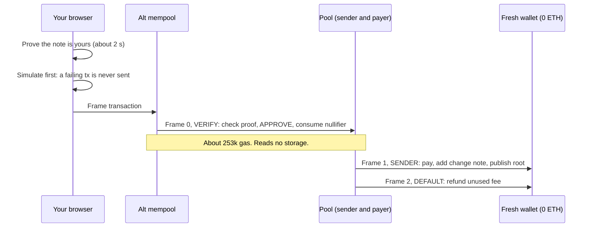

# Relayless

**Pay anyone privately, from a wallet with no history. No relayer. It tells you how hidden you are before you pay.**

> **Status:** works end to end on a local devnet (ethrex `9aa3645d` plus a patched alt mempool sidecar), which the alt mempool authors confirmed is fine for judging. The public gateway can't admit these transactions yet: see [Findings](#findings-for-the-alt-mempool). Devnet only.

## What you get
Privacy pools with no relayer have been prototyped. This is the layer that makes one usable:

- **One seed, nothing to back up.** Your wallet signs once. Notes and fresh addresses derive from that signature, and everything, change notes included, can be rebuilt from the chain on any device.
- **Pay any amount.** Partial payments leave a change note. A payment bigger than any one note splits across several, all pending at once.
- **Withdrawals don't wait for each other.** Each one has its own nullifier as its nonce key, and validation reads no storage. So one pool can serve many users at the same moment.
- **See how hidden you are.** Every deposit is drawn as a dot, sized by how suspicious it looks from outside. You get min-entropy and Shannon scores, plus advice you can act on: wait, split, or change the amount. It's an explicit model, not a guarantee.
- **Enforce it if you want.** Require at least *k* notes after yours, checked inside the proof.
- **Compliance path.** An optional association set: only approved deposits withdraw privately, and anyone else can always exit publicly to the wallet that deposited. *The set and the exit work locally. World ID is built but hasn't verified a real proof yet, and ENSv2 isn't started.*

## Findings for the alt mempool
Building a pool where every user shares one sender surfaced these, each reproducible:

| Finding | Evidence | Status |
|---|---|---|
| **Verification over 100k is rejected, even for a staked sender.** The cap runs before stake is looked up | Live gateway: `250000 exceeds MAX_VERIFY_GAS 100000`, from a sender with a real stake | Fixed in our local patch. [Repro](docs/repro-gateway.md) |
| **Precompile calls are rejected during validation, even under the cap** (`COD-010`), because `precompiles` is empty in the gateway's config | Live gateway rejects a 60k frame calling `0x06` | Config fix locally. [Repro](docs/repro-gateway.md) |
| **Replacements inflate reputation.** Each fee bump counted as a new `seen`, against ERC-8421's REPUTATION-040. **The alt mempool authors confirmed this as a prototype bug** | 8 bumps from one note: `seen` 0 → 8 before our fix, 0 → 1 after | Fixed in our patch. [Write-up for upstream](docs/upstream-pr.md) |
| **A note owner can grief the shared sender across nodes.** A node that never sees the tx mined keeps it against the pool | Same note sent to two nodes: `seen 2, included 0` on the non-mining one | **Open.** It needs a rule change. At that rate, throttling a node takes about 110 notes and banning about 510 (calculated, not reached) |

[Everything about reputation and griefing, with mitigations](docs/reputation-analysis.md).

The authors confirmed a local sidecar is fine for judging. Separately, ethrex lost the number lookup for a run of blocks on 2 of 2 fresh chains; the cause is unknown, and the SDK reads around it. See the [write-up](docs/upstream-pr.md#separate-issue-ethrex-loses-block-numbers).

## How it works
EIP-8141 frame transactions let the pool be the sender and pay gas from the note being withdrawn. A fresh wallet receives money without ever holding ETH.



| Mechanism | How |
|---|---|
| Double spends | The nullifier is an EIP-8250 nonce key, consumed atomically with payment approval. A second spend is an invalid transaction, not a paid failure |
| Root | Referenced as an EIP-8272 recent root, not read from storage. Bound to the leaf count, for the k-gate |
| Binding | The proof sits in an `ARBITRARY` signature and commits to `sigHash`, so recipient, fee and every frame are fixed |
| Pool safety | The validator pins the exact transaction shape, and `maxCost ≤ fee ≤ amount`, so one note can't spend others' money |
| Note safety | The SENDER frame cannot revert after APPROVE. A refused payment becomes a claim, not a lost note |

**The most interesting problem is the shared sender.** Reputation drops for every transaction admitted but not mined, and every user shares the pool's. [docs/reputation-analysis.md](docs/reputation-analysis.md) lists every way this can happen, with griefing measurements, what we mitigated, and what needs a rule change.

## Run it
Needs Docker (running), Node, pnpm and Foundry. From a fresh clone, one command brings up a private local chain and the patched alt mempool, then deploys:

```sh
scripts/local-stack.sh   # about 13 minutes the first time: frame transactions activate about 11 minutes after genesis
pnpm web                 # http://127.0.0.1:5199
```

Everything binds to localhost, and the keys it creates are throwaway. It's safe to rerun: it reuses a running stack and deploys a fresh pool. To stop, run the command it prints at the end.

The association-set pool and World ID are optional: see [docs/world-id-setup.md](docs/world-id-setup.md).

Tests:

```sh
pnpm test:circuits && pnpm test:contracts && pnpm test:sdk && pnpm test:asp
set -a; . ./.env; set +a
pnpm e2e                 # against the running stack
```

SDK:

```ts
const rl = await Relayless.connect({ rpc, mempool, pool, signer, prover });
await rl.deposit({ amount });
await rl.pay({ to, amount, minAnon: 32 });
const a = await rl.anonymity({ amount }); // { minEntropyBits, shannonBits, setSize, advice }
```

CLI: `npx tsx packages/cli/src/cli.ts deposit|withdraw|anonymity|recover|fresh|ragequit`

## CROPS
- **C:** We run no server, relayer or RPC. You depend on a mempool node and an RPC, which anyone can run. If a node refuses you, use another. The pool has no owner and can't be upgraded or paused. The exception is the association set, if a pool uses one: its operator decides who can withdraw privately, and public exit stays open regardless.
- **O:** GPL-3.0, because circomlib's GPL-3.0 circuits are compiled into the project (see [NOTICE.md](NOTICE.md)). Builds and runs from this repo, using a patched third-party sidecar until the public gateway supports it.
- **P:** The RPC and mempool node see your IP, and everything on-chain is public: deposits, amounts, recipients, and *k*. Reads fetch all deposits, so they don't reveal which are yours. No trackers or analytics: a full browser run contacted no outside host, and fonts are self-hosted. On a pool with an association set, choosing to verify contacts World, and the ASP links a World ID nullifier to a depositor address, which is already public. Anon-RPC isn't integrated, as its docs list no devnet support.
- **S:** Keys stay on your device and derive from a wallet signature held in memory. The test wallet keeps a throwaway key in browser storage, so it's for devnets only. Trust assumptions: the circuits, the validator (neither audited), and a Groth16 setup that is **devnet-grade**, since anyone with its one local contribution could forge proofs.

## Threat model
**Protects against:** an observer linking your deposit to your payment through gas funding; a relayer seeing or refusing you (there isn't one); someone spending a note they don't own; someone changing a payment's recipient or fee; one note taking other depositors' money.

**Doesn't protect against:**
- The node you submit to, which sees your IP.
- Timing and amount analysis. The meter estimates this but can't remove it.
- A small pool. With few deposits, you're easy to pick out.
- A note owner griefing the pool's reputation. This is bounded, not solved.
- Whoever holds the setup's toxic waste.

## Limitations
- **Runs on a patched local sidecar.** The public gateway needs per-entity budgets and precompiles allowed. The same transaction simulates successfully against the public chain, and its gateway refuses it.
- **Devnet only.** These EIPs aren't on mainnet, and the devnet predates their current text, for example in how recent roots are carried.
- **Not audited.** Groth16 isn't post-quantum. Trusted setup is devnet-grade.
- **Withdrawals need the pool to be staked** under the ERC draft's budgets, and the stake can't be withdrawn.
- **A banned pool blocks everyone at that node**, including public exits, until `seen` decays or you use another node.
- **World ID is built but hasn't verified a real proof:** it needs an app's credentials. Its tests fake World's verdict. ENSv2, pay-to-ENS and Anon-RPC aren't integrated.
- Proving hasn't been timed on a phone.

## Options
**Fee-bump limit, off by default.** Build the validator with `RELAYLESS_FEE_RANGE=<min wei>:<max wei>` to reject max fees outside a fixed range, which caps fee bumps per note. It limits griefing on a node that still counts replacements, but withdrawals stall when the base fee passes the ceiling. See the [analysis](docs/reputation-analysis.md#the-optional-fee-bump-limit).

## Gas
A withdrawal to a fresh wallet costs about 950,000 gas, of which **253,176** is verification. Full figures: [docs/gas-report.md](docs/gas-report.md).

## Prior work
- [EIP-8141 and minimum required validation budget for privacy applications](https://ethresear.ch/t/eip-8141-and-minimum-required-validation-budget-for-privacy-applications/25889) (mmjahanara): the gas floor and optimizations.
- [Ephemeral rollup: the new L1.5 of Ethereum](https://ethresear.ch/t/ephemeral-rollup-the-new-l1-5-of-ethereum/26187) (namnc): the prior working frame layout for privacy pool redemption.
- [Frame transactions and the three gates to privacy](https://ethresear.ch/t/frame-transactions-and-the-three-gates-to-privacy/24666) (nero_eth): mempool rules for privacy transactions.
- [Privacy Pools](https://github.com/0xbow-io/privacy-pools-core) (0xbow): circuits, association sets and ragequit, adapted with attribution.
- [Alt mempool workshop and sidecar](https://github.com/forshtat/mempool-workshop) (forshtat), and direct feedback from the alt mempool authors.

## Docs
[Reputation analysis](docs/reputation-analysis.md), [gateway repro](docs/repro-gateway.md), [upstream fix](docs/upstream-pr.md), [World ID setup](docs/world-id-setup.md), [gas report](docs/gas-report.md), [research notes](docs/research-notes.md), [demo script](docs/demo-script.md), [decisions](DECISIONS.md), [progress](PROGRESS.md).
