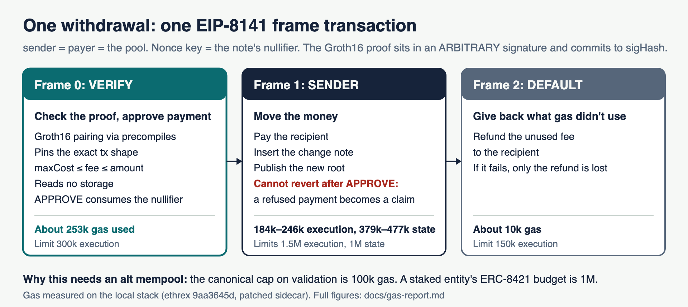

# Relayless

🥇 1st place, EF: Best use of the Frame Transaction Alternative Mempool, ETHGlobal Mumbai 2026. The hackathon version is tagged `v1.0-ethglobal-mumbai`.

**Pay anyone privately, from a wallet with no history. No relayer. It tells you how hidden you are before you pay.**

- **What:** a privacy pool that pays gas from the note being withdrawn, so a brand-new wallet holding 0 ETH can receive money with nobody funding it, using EIP-8141 frame transactions and the alt mempool.
- **Where it fits:** the pool primitive builds on prior work, where [soispoke's reference pool](https://github.com/soispoke/minimal-shielded-pool) leads. Relayless adds the ERC-8421 alt mempool path, measured shared-sender reputation, a provider-agnostic compliance layer, and the SDK. See [docs/landscape.md](docs/landscape.md).
- **Run it:** `scripts/local-stack.sh && pnpm web`, then open http://127.0.0.1:5199. See [Run it](#run-it).


| Part | What's real | Where it runs |
|---|---|---|
| Core: frame withdrawals, recovery, meter, k-gate | Works end to end on both spec profiles: 34 e2e checks on `devnet-8421`, 32 on `hegota-8141` | `devnet-8421`: ethrex `9aa3645d` plus a patched ERC-8421 sidecar (the alt mempool path). `hegota-8141`: a local chain on ethrex `64b8fc09`, the revision the public Hegotá testnet runs. See [Spec profiles](#spec-profiles) |
| Association sets and public exit | Works with any provider through one SDK interface, with an allowlist ASP as the reference | Both profiles, locally. See [Association sets](#association-sets) |
| Public testnet (chain 8141) | Deployed twice, 5/5 each time: deposit, private withdrawal to a 0-ETH address, double spend refused, 3 concurrent withdrawals, public exit. The current pool uses the compressed statement, declaring 268,100 gas of validation | See [Public testnet](#public-testnet) |

Testnets and local chains only. Not audited.

## What you get
Privacy pools with no relayer have been prototyped. This is the layer that makes one usable:

- **One seed, nothing to back up.** Your wallet signs once. Notes and fresh addresses derive from that signature, and everything, change notes included, can be rebuilt from the chain on any device.
- **Pay any amount.** Partial payments leave a change note. A payment bigger than any one note splits across several, all pending at once.
- **Withdrawals don't wait for each other.** Each one has its own nullifier as its nonce key, and validation reads no storage. So one pool can serve many users at the same moment.
- **See how hidden you are.** Every deposit is drawn as a dot, sized by how suspicious it looks from outside. You get min-entropy and Shannon scores, plus advice you can act on: wait, split, or change the amount. It's an explicit model, not a guarantee.
- **Enforce it if you want.** Require at least *k* notes after yours, checked inside the proof.
- **Compliance path.** An optional association set: only approved deposits withdraw privately, and anyone else can always exit publicly to the wallet that deposited. Any association set provider plugs in, such as an allowlist or 0xbow's ASP. See [Association sets](#association-sets).

## Findings for the alt mempool
Building a pool where every user shares one sender surfaced these, each reproducible:

| Finding | Evidence | Status |
|---|---|---|
| **Verification over 100k is rejected, even for a staked sender.** The cap runs before stake is looked up | Live gateway: `250000 exceeds MAX_VERIFY_GAS 100000`, from a sender with a real stake | Fixed in our local patch. [Repro](docs/repro-gateway.md) |
| **Precompile calls are rejected during validation, even under the cap** (`COD-010`), because `precompiles` is empty in the gateway's config | Live gateway rejects a 60k frame calling `0x06` | Config fix locally. [Repro](docs/repro-gateway.md) |
| **Replacements inflate reputation.** Each fee bump counted as a new `seen`, against ERC-8421's REPUTATION-040. **The alt mempool authors confirmed this as a prototype bug** | 8 bumps from one note: `seen` 0 → 8 before our fix, 0 → 1 after | Fixed in our patch. [Write-up for upstream](docs/upstream-pr.md) |
| **A note owner can grief the shared sender across nodes.** A node that never sees the tx mined keeps it against the pool | Same note sent to two nodes: `seen 2, included 0` on the non-mining one | **Open.** It needs a rule change. At that rate, throttling a node takes about 110 notes and banning about 510 (calculated, not reached) |

### Why allowing precompiles in validation is safe
ERC-8421's CALLING-040 already allows `0x01–0x11` and `P256VERIFY`, and only the gateway's config blocks them. These precompiles are:

- **Pure and deterministic:** the output depends only on the input, so a result can't differ because of who runs it or when.
- **Stateless:** they read no storage, balance, code or block data, and write nothing.
- **Gas-bounded:** each call is priced from its input and counts against the entity's validation budget, so a transaction can't spend more than it declared.

So they add no mass-invalidation risk for builders. Nothing another transaction does can change a precompile's result, and a precompile call can't change anything another transaction depends on, so a block landing gives a builder nothing extra to revalidate.

**What else changes:** allowing precompiles is a config value. [The patch](patches/sidecar-budget-010.patch) otherwise changes only per-entity gas budgets (BUDGET-010), plus the replacement fix (REPUTATION-040).

**One limit:** this is about correctness, not cost. Gas doesn't price CPU evenly, and [Nethermind's follow-up to the budget research](https://ethresear.ch/t/eip-8141-and-minimum-required-validation-budget-for-privacy-applications/25889) reports a real circuit costing about 3.3x more CPU per gas than a synthetic one. So the budget is what limits node work, and a node should set it with that in mind.

[Everything about reputation and griefing, with mitigations](docs/reputation-analysis.md).

The authors confirmed a local sidecar is fine for judging. Separately, ethrex lost the number lookup for a run of blocks on 2 of 2 fresh chains; the cause is unknown, and the SDK reads around it. See the [write-up](docs/upstream-pr.md#separate-issue-ethrex-loses-block-numbers).

## How it works
EIP-8141 frame transactions let the pool be the sender and pay gas from the note being withdrawn. A fresh wallet receives money without ever holding ETH.




On `hegota-8141`, a fourth frame leads: EIP-8272's recent-root verifier, a VERIFY frame to the recent-root contract carrying the roots the proof uses. On `devnet-8421` those roots travel in an envelope field.

| Mechanism | How |
|---|---|
| Double spends | The nullifier is an EIP-8250 nonce key, consumed atomically with payment approval. A second spend is an invalid transaction, not a paid failure |
| Root | Referenced as an EIP-8272 recent root, not read from storage. Bound to the leaf count, for the k-gate |
| Binding | The proof sits in an `ARBITRARY` signature and commits to `sigHash`, so recipient, fee and every frame are fixed |
| Pool safety | The validator pins the exact transaction shape, and `maxCost ≤ fee ≤ amount`, so one note can't spend others' money |
| Note safety | The SENDER frame cannot revert after APPROVE. A refused payment becomes a claim, not a lost note |

**The most interesting problem is the shared sender.** Reputation drops for every transaction admitted but not mined, and every user shares the pool's. [docs/reputation-analysis.md](docs/reputation-analysis.md) lists every way this can happen, with griefing measurements, what we mitigated, and what needs a rule change.

## Spec profiles
EIP-8141, EIP-8250 and EIP-8272 are drafts that changed in October 2026, and the chains that run them follow different revisions. A pool is built for one **spec profile**, because its validator's bytecode depends on it:

| Profile | Follows | Where | Withdrawals go to |
|---|---|---|---|
| `devnet-8421` | ethrex `9aa3645d`: recent roots in an envelope field | `scripts/local-stack.sh` | The ERC-8421 alt mempool (sidecar), with the pool staked |
| `hegota-8141` | ethrex `64b8fc09`: EIP-8141 `7d1c8bfb94`, EIP-8250 `f3079a09e8`, EIP-8272 `824cbc0b0e`. Recent roots in a VERIFY frame | `scripts/local-stack-hegota.sh`, and the public chain 8141 | The node's own public mempool, which admits up to 500,000 verify gas. No stake |

The circuits, pool contract, recovery, meter, k-gate and association sets are shared. What differs lives in `packages/sdk/src/profiles.ts` and the validator generator's profile table. A third profile for today's EIP texts (`eips-current`, which only Nethermind master implements) can be added there without touching shared code. Why it isn't built yet, and everything else about the port, is in [docs/spec-port.md](docs/spec-port.md).

## Run it
Needs Docker (running), Node, pnpm and Foundry. From a fresh clone, one command brings up a private local chain and the patched alt mempool, then deploys (the `devnet-8421` profile):

```sh
scripts/local-stack.sh   # about 13 minutes the first time: frame transactions activate about 11 minutes after genesis
pnpm web                 # http://127.0.0.1:5199
```

Everything binds to localhost, and the keys it creates are throwaway. It's safe to rerun: it reuses a running stack and deploys a fresh pool. To stop, run the command it prints at the end.

The association-set pool is optional. `scripts/setup-asp.sh` deploys it on the running stack, and `pnpm demo:asp` starts its reference ASP on port 8790.

**Demo mode.** Open the app with `?demo=1` for the demo buttons and fewer raw addresses on screen. The demo runs on the association-set pool:

```sh
scripts/setup-asp.sh                        # once per stack: the association-set pool
pnpm demo:asp                               # its allowlist ASP, on 8790, in its own terminal
pnpm demo:seed                              # demo data, see below
pnpm demo:reset                             # a new wallet and fresh recipient, for each take
RELAYLESS_NETWORK=local-asp pnpm web
pnpm demo:prep                              # a green or red line for everything; --fix runs the safe fixes
```

**Demo data, clearly:** `demo:seed` makes 56 deposits from throwaway keys into that pool, so the meter and dot chart have a crowd. **Those dots are seed data, not users.** They and the demo wallet are approved directly by the allowlist ASP's operator, which is that ASP's stated policy.

**The `hegota-8141` profile, locally.** Needs Rust, Node, pnpm and Foundry, no Docker. The first run builds ethrex `64b8fc09` from source, about 10–20 minutes:

```sh
scripts/local-stack-hegota.sh                         # ethrex in dev mode, chain id 81410, then deploys
set -a; . .relayless/hegota-stack/keys.env; set +a
pnpm e2e local-hegota
```

Tests:

```sh
pnpm test:circuits && pnpm test:contracts && pnpm test:sdk && pnpm test:asp
pnpm typecheck && pnpm build
set -a; . ./.env; set +a
pnpm e2e                                   # against the running stack
pnpm e2e:asp                               # the association-set pool, after scripts/setup-asp.sh
npx tsx scripts/adversarial.ts local       # ten hostile recipients, each paid by a real withdrawal
npx tsx scripts/gas-floors.ts local        # the SENDER frame's worst case at full tree depth
```

The same commands take `local-hegota` (and `scripts/setup-asp.sh local-hegota .relayless/hegota-stack/keys.env`, then `pnpm e2e:asp local-hegota-asp`). CI runs the unit suites on every push, and both profiles' end-to-end suites on demand and nightly.

Latest results are in [PROGRESS.md](PROGRESS.md).

SDK:

```ts
const rl = await Relayless.connect({ rpc, mempool, profile: "hegota-8141", pool, signer, prover });
await rl.deposit({ amount });
await rl.pay({ to, amount, minAnon: 32 });
const a = await rl.anonymity({ amount }); // { minEntropyBits, shannonBits, setSize, advice }
```

CLI: `npx tsx packages/cli/src/cli.ts deposit|withdraw|anonymity|recover|fresh|ragequit`

## Association sets
A pool can require that a note's label is in an approved set before it leaves privately. Whoever is left out can always exit publicly, to the address that deposited. That's the Privacy Pools model, carried into frame transactions.

- **Any provider.** The SDK speaks to an association set provider (ASP) through one interface, `AssociationSetProvider`: the current root, a membership proof for a label, an approval status, and the root's on-chain source id. The allowlist server in `apps/asp` is the reference implementation. [How a third-party ASP, such as 0xbow's, would implement it](docs/association-sets.md).
- **What the chain enforces.** The pool accepts roots from exactly one EIP-8272 source, fixed at deployment. The validator checks the root against the chain, and the circuit checks membership against the root. So a provider can withhold or over-approve, but it can't fake a root or a proof, move money, or block the public exit.
- **Checked before sending.** The SDK refuses a provider whose source isn't the pool's, and a proof that doesn't reach its root. It simulates before broadcasting, so a root the chain doesn't hold is caught without costing the pool reputation.

The hackathon version also had a World ID ASP, an ENSv2 directory of ASPs on Sepolia, private receive names, and an optional Nym route. They're in the tag `v1.0-ethglobal-mumbai`, and the Sepolia contracts stay deployed with their subregistry roles revoked.

## Public testnet
Relayless runs on the Hegotá privacy testnet, chain 8141, run by the ethrex team: RPC `https://rpc1.privacy.ethrex.xyz`, explorer [dora.privacy.ethrex.xyz](https://dora.privacy.ethrex.xyz). The node runs ethrex `64b8fc09`, so the pool uses the `hegota-8141` profile. Withdrawals go to the chain's own public mempool: no alt mempool, no stake, no relayer.

### Current pool: compressed statement (2026-11-17, 5/5)
The withdrawal proof exposes 3 public signals instead of 7 (eprint 2025/1500). Each withdrawal declares **268,100 gas of validation**, under Nethermind's 300,000 default, and verification uses 213,492.

| Contract | Address |
|---|---|
| RelaylessPool | [`0xab5d3d27…`](https://dora.privacy.ethrex.xyz/address/0xab5d3d27d192af9bcb1eafc953ba695baea0c7be) |
| Validator (`hegota-8141`, compressed) | [`0x7c856692…`](https://dora.privacy.ethrex.xyz/address/0x7c8566920a28bbb8c149916eb67624c3b723e316) |
| PoseidonT3 / T4 | [`0xcc177be1…`](https://dora.privacy.ethrex.xyz/address/0xcc177be185c2c5ce091d303a65ad29dd3d109667) / [`0x608aa24c…`](https://dora.privacy.ethrex.xyz/address/0x608aa24c4278fb2eefe0a0b750212760930c60ae) |

| Step | Result | Transaction |
|---|---|---|
| Deposit | 5 notes of 0.02 ETH (first shown) | [`0x0ccf6522…`](https://dora.privacy.ethrex.xyz/tx/0x0ccf6522cddf0b42f7caddea7440eb339016ec246eaa23ae2c1b93320a615f0b) |
| Private withdrawal to a fresh address holding 0 ETH | `0x886e…4Cd6` went from 0 to 0.014999 ETH. 4 frames, all succeeded. **916,820 gas** (was 941,778): root frame 5,579, pool VERIFY **207,913** + 97,920 state (was 233,383), SENDER 193,729 + 379,440 state, refund 9,967 | [`0x543a9ad3…`](https://dora.privacy.ethrex.xyz/tx/0x543a9ad335af2202d696d9bdae7c242c30f952f44f06b9eb512dbdfc24236ed8) |
| Double spend of the same note | Refused by the node's simulation before broadcast: "Nonce mismatch: expected 1, got 0". Nothing was sent | none |
| Concurrent withdrawals from the one pool sender | 3 of 3 pending at once, all mined in block 859307. This chain relaxes one-pending-per-sender for disjoint nonce keys; it has no MATCHA width budget, so this isn't a MATCHA result | [`0x7dabc6e6…`](https://dora.privacy.ethrex.xyz/tx/0x7dabc6e6d7d93be1e2a589f1458b0cce291cc8589b9eef7d19daadc134181e1b), [`0x1d02aa24…`](https://dora.privacy.ethrex.xyz/tx/0x1d02aa2465ea150ef9dded3c163d8515efb359d10a779ae604b0aaa39d9e62d4), [`0x8e87a405…`](https://dora.privacy.ethrex.xyz/tx/0x8e87a40519350a210841ea1c2c6c56f2914b92da6411c2807819f5d121ad5f7f) |
| Public exit (ragequit) to the depositor | Paid the depositor, nullifier spent | [`0x7d6d3ffb…`](https://dora.privacy.ethrex.xyz/tx/0x7d6d3ffb622f6787e51bcf6c5ea5d7b506db0597caf29e99a365aa0d98e15897) |

### First pool: seven public inputs (2026-11-16, 5/5), kept as history
The first deployment, before compression. Its change notes stay in it, and spending them needs the old proving key, which is in git at `9e9536c`.

| Contract | Address |
|---|---|
| RelaylessPool | [`0x6d58de3f…`](https://dora.privacy.ethrex.xyz/address/0x6d58de3fc7d80705ef2077b1d3b6aef1e87bb225) |
| Validator (`hegota-8141`) | [`0x72fb50da…`](https://dora.privacy.ethrex.xyz/address/0x72fb50da9fe63c68bf886ffc1e6a97e9d097421c) |
| PoseidonT3 / T4 | [`0xd194af1a…`](https://dora.privacy.ethrex.xyz/address/0xd194af1a6891ec6f6e34c961ed2639b430c0ff84) / [`0x308c0bee…`](https://dora.privacy.ethrex.xyz/address/0x308c0bee488fa6be3b7ce828135999cf56a2f256) |

| Step | Result | Transaction |
|---|---|---|
| Deposit | 5 notes of 0.02 ETH (first shown) | [`0x918de453…`](https://dora.privacy.ethrex.xyz/tx/0x918de453d28bd9b79a4d12235aa26a21c0e04d789f15b3b20fed448a9ea5175e) |
| Private withdrawal to a fresh address holding 0 ETH | `0xF085…F3b7` went from 0 to 0.014999 ETH. 4 frames, all succeeded. 941,778 gas: root frame 5,579, pool VERIFY 233,383 + 97,920 state, SENDER 193,729 + 379,440 state, refund 9,967 | [`0x9671febc…`](https://dora.privacy.ethrex.xyz/tx/0x9671febcc7365da4f5761559979b6776e0271ff12efbb6e6eac7ba508ffc2ef4) |
| Double spend of the same note | Refused by the node's simulation before broadcast: "Nonce mismatch: expected 1, got 0". Nothing was sent | none |
| Concurrent withdrawals from the one pool sender | 3 of 3 pending at once, mined in blocks 851714, 851715, 851715. This chain relaxes one-pending-per-sender for disjoint nonce keys; it has no MATCHA width budget, so this isn't a MATCHA result | [`0x9a4f521d…`](https://dora.privacy.ethrex.xyz/tx/0x9a4f521d474c685cee9d02eaf254948e6a921806c398e4a1e9692093f3489ce1), [`0x0511e178…`](https://dora.privacy.ethrex.xyz/tx/0x0511e1786a9484325b565937815f5868d6e62731803dfb712eac839eb7f5a59a), [`0x9679fdd5…`](https://dora.privacy.ethrex.xyz/tx/0x9679fdd5303c63c614ce1d3dcb277a2ab453b1134f11c6b39a2de526097c6508) |
| Public exit (ragequit) to the depositor | Paid the depositor, nullifier spent | [`0x12b5c7f7…`](https://dora.privacy.ethrex.xyz/tx/0x12b5c7f75cf85729adc4532f861497fb2ba9c1ad375bb80d4057ef6798b004e9) |

The deployer was a throwaway key funded from the testnet faucet. How to rerun: [docs/testnet-run.md](docs/testnet-run.md). Raw results of both runs: [docs/testnet-runs/](docs/testnet-runs/).

## CROPS
- **C:** We run no server, relayer or RPC. You depend on a mempool node and an RPC, which anyone can run. If a node refuses you, use another. The pool has no owner and can't be upgraded or paused. The exception is the association set, if a pool uses one: its operator decides who can withdraw privately, and public exit stays open regardless.
- **O:** GPL-3.0, because circomlib's GPL-3.0 circuits are compiled into the project (see [NOTICE.md](NOTICE.md)). Builds and runs from this repo, using a patched third-party sidecar until the public gateway supports it.
- **P:** The RPC and mempool node see your IP, and everything on-chain is public: deposits, amounts, recipients, and *k*. Reads fetch all deposits, so they don't reveal which are yours. No trackers or analytics: a full browser run contacted no outside host, and fonts are self-hosted. On a pool with an association set, the client downloads the whole approved set and builds proofs locally, so the ASP doesn't learn which note is about to be spent. The ASP does see whatever its own approval process asks for. Anon-RPC isn't integrated, as its docs list no devnet support.
- **S:** Keys stay on your device and derive from a wallet signature held in memory. The test wallet keeps a throwaway key in browser storage, so it's for devnets only. Trust assumptions: the circuits, the validator (neither audited), and a Groth16 setup that is **devnet-grade**, since anyone with its one local contribution could forge proofs.

## Threat model
**Protects against:** an observer linking your deposit to your payment through gas funding; a relayer seeing or refusing you (there isn't one); someone spending a note they don't own; someone changing a payment's recipient or fee; one note taking other depositors' money.

**Doesn't protect against:**
- The node you submit to, which sees your IP.
- Timing and amount analysis. The meter estimates this but can't remove it.
- A small pool. With few deposits, you're easy to pick out.
- A note owner griefing the pool's reputation. This is bounded, not solved.
- Whoever holds the setup's toxic waste.

**What an association set provider can and can't do:**
- **Can:** decide who is approved, so it can withhold approval or approve too much, and see whatever its own approval process collects.
- **Can't:** approve a label without its root on the chain, forge membership, change the pool's source, touch anyone's money, or block the public exit.

## Limitations
- **The alt mempool path runs on a patched local sidecar.** The public gateway needs per-entity budgets and precompiles allowed. The same transaction simulates successfully against the public chain, and its gateway refuses it. The `hegota-8141` profile doesn't need the alt mempool, because chain 8141's public mempool admits 500,000 verify gas.
- **Testnets only.** These EIPs aren't on mainnet. Neither profile follows today's EIP texts exactly: see [Spec profiles](#spec-profiles).
- **The validation budget is above EIP-8141's 100,000** on every profile: 268,100 declared and 213,492 used on `hegota-8141`, 260,100 declared and 227,598 used on `devnet-8421`. It needs a node that admits more, as chain 8141 (500,000) and Nethermind's default (300,000) do.
- **Not audited.** Groth16 isn't post-quantum. Trusted setup is devnet-grade.
- **On the alt mempool path, withdrawals need the pool to be staked** under the ERC draft's budgets, and the stake can't be withdrawn.
- **A banned pool blocks everyone at that node**, including public exits, until `seen` decays or you use another node.
- **One association set provider per pool.** The source is fixed at deployment. A pool taking several providers would need a contract and validator change. Anon-RPC isn't integrated.
- Proving hasn't been timed on a phone.
- **The demo's crowd is seed data,** and its wallet is approved by the allowlist ASP's operator. See [Demo mode](#run-it).

## Options
**Fee-bump limit, off by default.** Build the validator with `RELAYLESS_FEE_RANGE=<min wei>:<max wei>` to reject max fees outside a fixed range, which caps fee bumps per note. It limits griefing on a node that still counts replacements, but withdrawals stall when the base fee passes the ceiling. See the [analysis](docs/reputation-analysis.md#the-optional-fee-bump-limit).

## Gas
A withdrawal to a fresh wallet costs about 875,000–925,000 gas on `devnet-8421`, of which **227,598** is verification. On `hegota-8141` it's about 915,000–1,005,000 (916,820 on the public chain), of which **213,492** is verification: 5,579 for the recent-root frame and 207,913 for the pool's. The rest of the difference is the nullifier slot's state gas. Compressing the withdrawal statement to 3 public signals saved about 25,500 gas of verification on each profile. Proving takes about 2 s on a laptop. Full figures: [docs/gas-report.md](docs/gas-report.md).

## Prior work
- [EIP-8141 and minimum required validation budget for privacy applications](https://ethresear.ch/t/eip-8141-and-minimum-required-validation-budget-for-privacy-applications/25889) (mmjahanara): the gas floor and optimizations.
- [Ephemeral rollup: the new L1.5 of Ethereum](https://ethresear.ch/t/ephemeral-rollup-the-new-l1-5-of-ethereum/26187) (namnc): the prior working frame layout for privacy pool redemption.
- [Frame transactions and the three gates to privacy](https://ethresear.ch/t/frame-transactions-and-the-three-gates-to-privacy/24666) (nero_eth): mempool rules for privacy transactions.
- [Privacy Pools](https://github.com/0xbow-io/privacy-pools-core) (0xbow): circuits, association sets and ragequit, adapted with attribution.
- [minimal-shielded-pool](https://github.com/soispoke/minimal-shielded-pool) (soispoke): the reference shielded pool on frame transactions, with the same core design (pool as sender, nullifiers as EIP-8250 keys, EIP-8272 roots, a Yul validator, settlement that can't fail after approval) and the current-spec profile.
- [A privacy pool on frame transactions: what works, and the case that does not yet](https://ethresear.ch/t/a-privacy-pool-on-frame-transactions-what-works-and-the-case-that-does-not-yet/26223) (Nethermind): measured costs and budgets on Nethermind.
- [MATCHA](https://ethresear.ch/t/mempool-account-transaction-capacity-from-historical-activity-matcha/25949) (soispoke, Vitalik, Toni): a public-mempool policy for shared senders.
- [Alt mempool workshop and sidecar](https://github.com/forshtat/mempool-workshop) (forshtat), and direct feedback from the alt mempool authors.

## Before vs during the hackathon
All of this repository's code is in its git history, from the first commit, `aa797f7`, dated 2026-11-05 22:54 IST. Run `git log --date=iso` to see every step. `docs/research-notes.md` records the Phase 0 spikes of 2026-11-05, which were throwaway and kept outside this repo, so none of their code is here.

| Dates in `git log` | What was committed |
|---|---|
| 2026-11-05 (11 commits, `aa797f7` to `f118a8c`) | Monorepo, circuits, pool and validator, SDK, local stack, e2e and CLI |
| 2026-11-06 to 2026-11-07 | Web app, association set and World ID, ENSv2, Nym, findings, demo aids and docs. This is the tag `v1.0-ethglobal-mumbai` |
| 2026-11-16 onward, branch `refocus` | Stage 2: World ID, ENS and Nym removed from the core, the association set made provider-agnostic, and the port to the current specs |

Third-party work is listed under [Prior work](#prior-work) and [NOTICE.md](NOTICE.md).

## AI usage
Claude Code was used for implementation, testing and documentation, under the author's direction. The ideas, steps and detailed specifications came from the author, who also designed, reviewed and validated the work.

## Docs
[Landscape](docs/landscape.md), [spec port](docs/spec-port.md), [testnet run](docs/testnet-run.md), [association sets](docs/association-sets.md), [code tour](docs/code-tour.md), [reputation analysis](docs/reputation-analysis.md), [gateway repro](docs/repro-gateway.md), [upstream fix](docs/upstream-pr.md), [gas report](docs/gas-report.md), [research notes](docs/research-notes.md), [demo script](docs/demo-script.md), [decisions](DECISIONS.md), [progress](PROGRESS.md).
